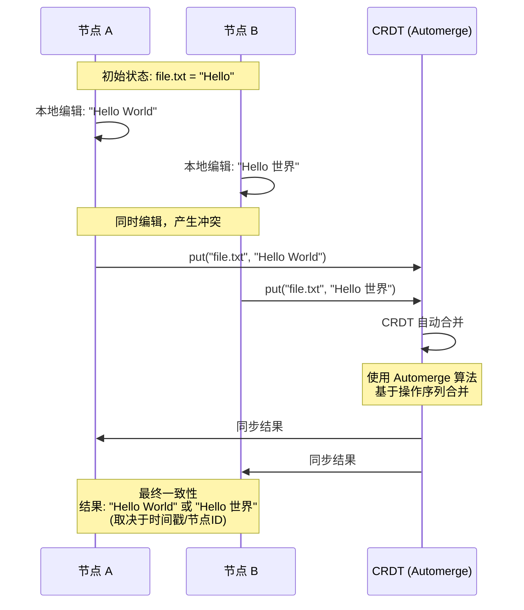
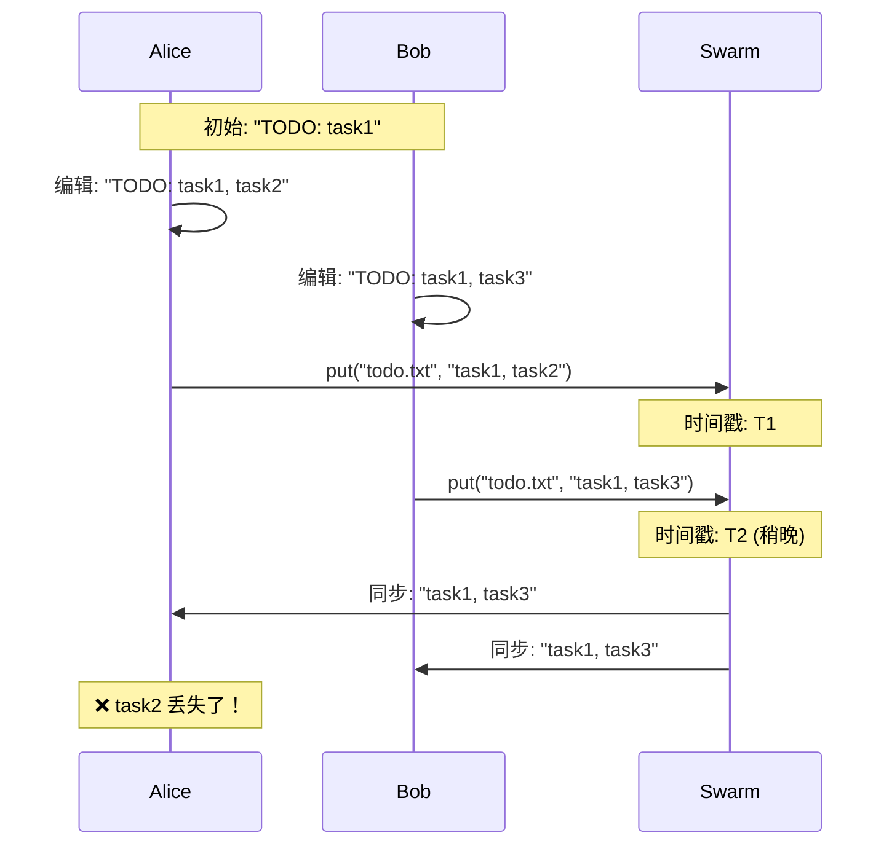
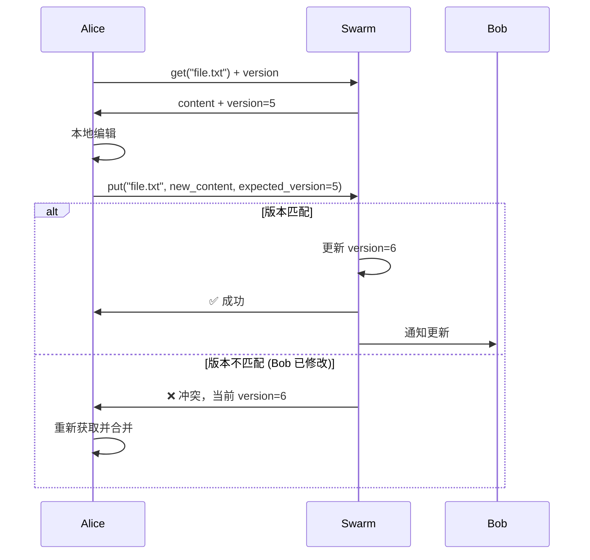
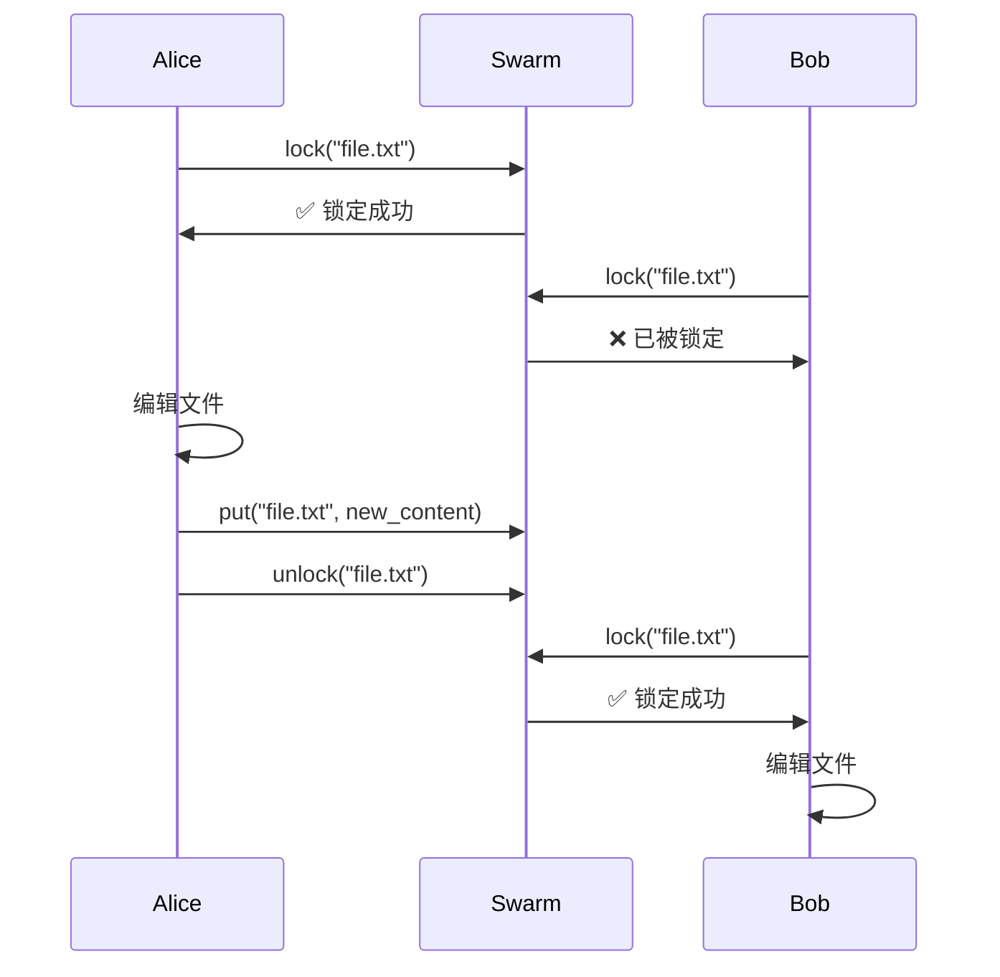
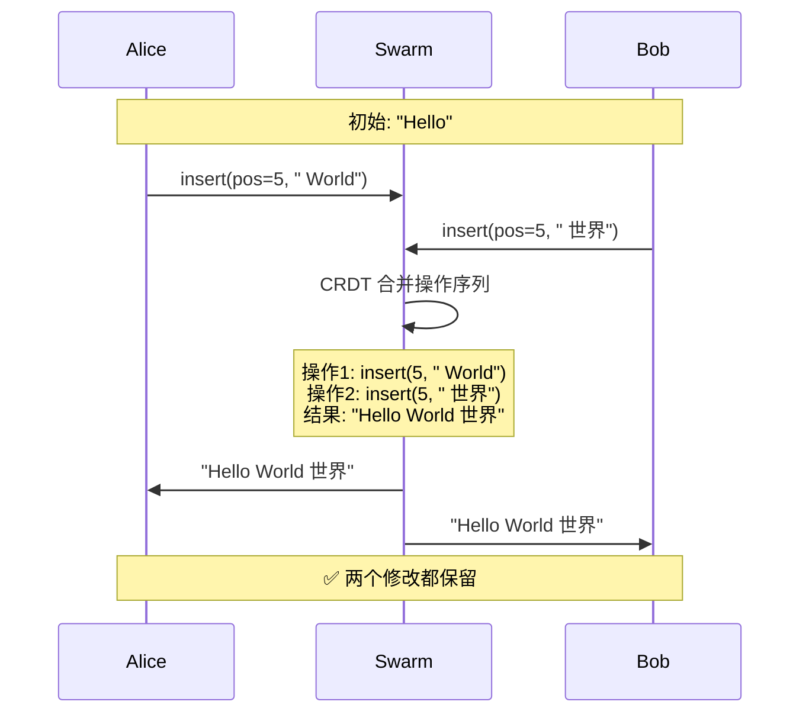
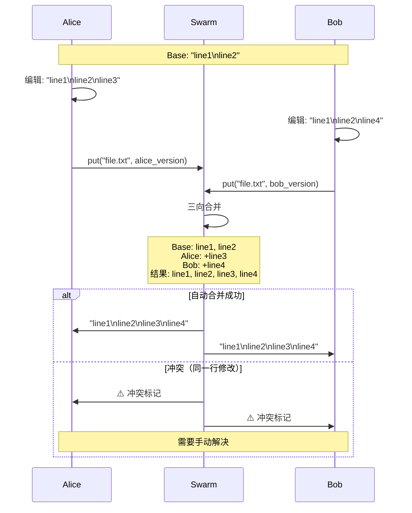
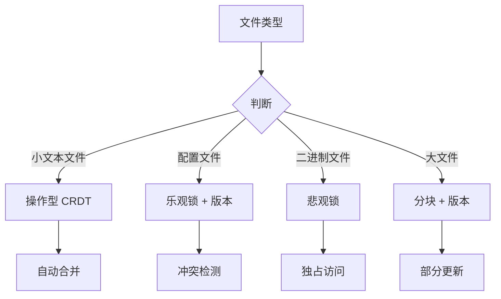

# 文件协同冲突解决机制

## 当前实现：CRDT 自动合并（无锁）



## 问题分析

### ❌ 当前方案的问题

1. **Last-Write-Wins (LWW)**
   - Automerge 对于整个文件替换，会选择最后一次写入
   - 先写入的修改会被覆盖
   - **数据丢失风险**

2. **无锁机制**
   - 任何节点随时可以修改
   - 无法阻止并发写入
   - 无法保证原子性

3. **无冲突提示**
   - 用户不知道发生了冲突
   - 不知道自己的修改被覆盖
   - 无法手动解决冲突

### 示例：数据丢失场景



## 解决方案对比

### 方案 1: 乐观锁 (Optimistic Locking)



**优点**:
- 检测到冲突
- 不会静默覆盖
- 用户可以手动解决

**缺点**:
- 需要重试逻辑
- 高并发时频繁失败

### 方案 2: 悲观锁 (Pessimistic Locking)



**优点**:
- 完全避免冲突
- 保证原子性

**缺点**:
- 需要 Leader 节点管理锁
- Leader 故障时锁失效
- 用户体验差（等待）

### 方案 3: 操作型 CRDT (Operational CRDT)



**优点**:
- 不丢失数据
- 自动合并
- 无需锁

**缺点**:
- 需要操作级别的 API
- 不适合整个文件替换
- 实现复杂

### 方案 4: 三向合并 (3-Way Merge)



**优点**:
- Git 风格，用户熟悉
- 可以自动合并大部分情况
- 冲突时有明确标记

**缺点**:
- 需要保存 Base 版本
- 冲突时需要手动解决

## 推荐方案

### 短期：乐观锁 + 版本号

```rust
// 在 file.rs 中添加
pub struct FileMetadata {
    pub original_name: String,
    pub size: u64,
    pub modified_at: u64,
    pub checksum: String,
    pub version: u64,  // 新增版本号
}

impl FileOps for Swarm {
    async fn put_file_with_version(
        &self,
        file_path: &Path,
        expected_version: Option<u64>
    ) -> Result<String> {
        // 1. 获取当前版本
        let current_meta = self.file_metadata(key).await?;

        // 2. 检查版本
        if let Some(expected) = expected_version {
            if current_meta.version != expected {
                return Err(Error::VersionConflict {
                    expected,
                    current: current_meta.version,
                });
            }
        }

        // 3. 更新文件 + 版本号
        let new_version = current_meta.version + 1;
        // ... 存储文件和新版本

        Ok(key)
    }
}
```

### 中期：操作型 CRDT (文本编辑)

```rust
// 新增 text_ops.rs 模块
pub trait TextOps {
    async fn insert(&self, key: &str, pos: usize, text: &str) -> Result<()>;
    async fn delete(&self, key: &str, pos: usize, len: usize) -> Result<()>;
    async fn get_text(&self, key: &str) -> Result<String>;
}

// 使用 Automerge 的文本类型
// 自动处理并发插入/删除
```

### 长期：混合方案



## 当前 Murmur 的实际行为

```rust
// 当前实现 (src/sync.rs)
pub async fn put(&self, key: &str, value: &[u8]) -> Result<()> {
    // 1. 直接写入 Automerge
    self.doc.put(key, value)?;

    // 2. 广播到所有节点
    self.broadcast_change().await?;

    // 3. 其他节点接收后直接应用
    // ❌ 没有冲突检测
    // ❌ 没有版本控制
    // ❌ Last-Write-Wins
}
```

## 建议实现优先级

1. **立即**: 添加版本号到 FileMetadata
2. **短期**: 实现 `put_file_with_version()` 乐观锁
3. **中期**: 为文本文件添加操作型 CRDT
4. **长期**: 根据文件类型选择策略

## 示例：改进后的 API

```rust
use murmur::{Swarm, FileOps};

// 方式 1: 无版本检查（当前行为）
swarm.put_file(path).await?;

// 方式 2: 乐观锁
let meta = swarm.file_metadata(&key).await?;
match swarm.put_file_with_version(path, Some(meta.version)).await {
    Ok(_) => println!("更新成功"),
    Err(Error::VersionConflict { expected, current }) => {
        println!("冲突！期望版本 {}, 当前版本 {}", expected, current);
        // 重新获取并合并
    }
}

// 方式 3: 文本操作（未来）
swarm.text_insert(&key, 10, "new text").await?;
swarm.text_delete(&key, 5, 3).await?;
```

## 总结

| 方案 | 冲突检测 | 数据丢失 | 实现难度 | 用户体验 |
|------|---------|---------|---------|---------|
| 当前 (LWW) | ❌ | ⚠️ 高 | ✅ 简单 | ⚠️ 差 |
| 乐观锁 | ✅ | ✅ 无 | ✅ 简单 | ✅ 好 |
| 悲观锁 | ✅ | ✅ 无 | ⚠️ 中等 | ❌ 差 |
| 操作型 CRDT | ✅ | ✅ 无 | ❌ 复杂 | ✅ 最好 |
| 三向合并 | ✅ | ✅ 无 | ⚠️ 中等 | ✅ 好 |

**推荐**: 先实现乐观锁（简单且有效），再逐步添加操作型 CRDT（最佳体验）。
