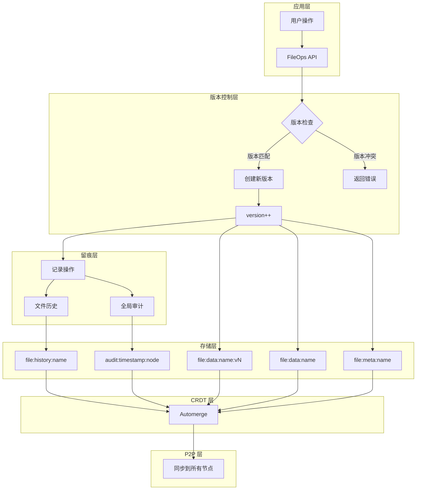
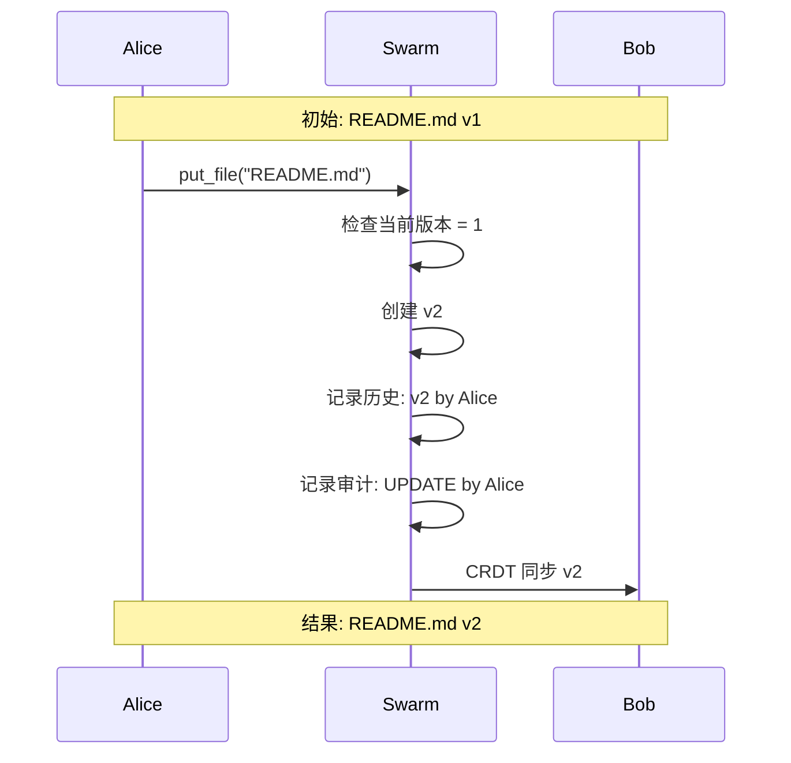
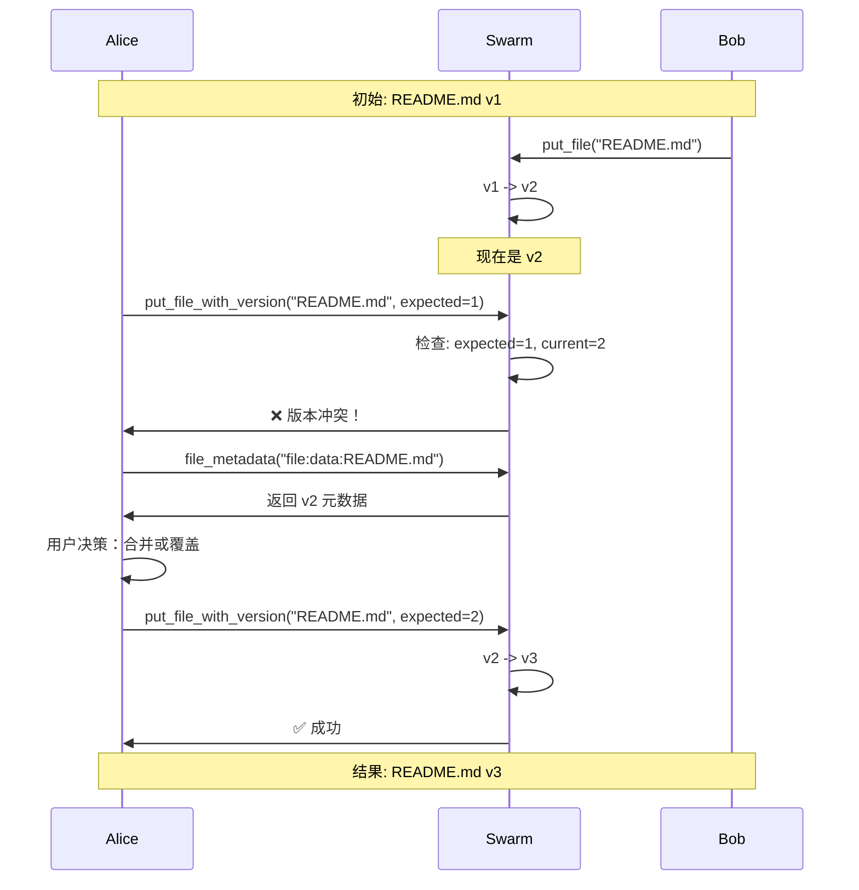
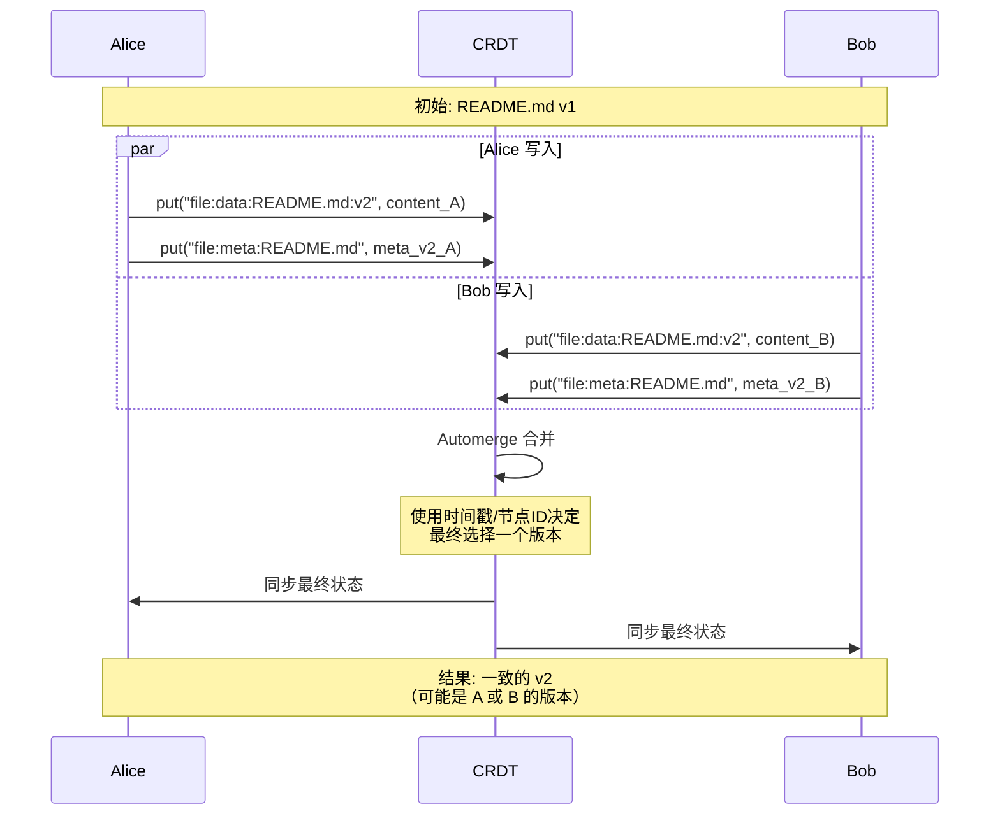

# 版本控制 + 留痕 + CRDT 架构

## 概述

Murmur 的文件操作现在采用三层防护机制：

1. **版本控制** - 每次修改都有版本号，支持回溯
2. **操作留痕** - 所有操作都记录在审计日志中
3. **CRDT 合并** - 底层自动解决网络层面的冲突

## 架构图



## 数据结构

### 文件元数据 (FileMetadata)

```rust
pub struct FileMetadata {
    pub name: String,        // 文件名
    pub size: usize,         // 文件大小
    pub modified: u64,       // 修改时间戳
    pub checksum: String,    // 校验和
    pub version: u64,        // 当前版本号 ⭐
    pub author: String,      // 作者节点 ID ⭐
}
```

### 版本历史 (FileVersion)

```rust
pub struct FileVersion {
    pub version: u64,           // 版本号
    pub content_key: String,    // 内容存储 key
    pub timestamp: u64,         // 时间戳
    pub author: String,         // 作者节点 ID
    pub size: usize,            // 文件大小
    pub operation: FileOperation, // 操作类型 ⭐
}

pub enum FileOperation {
    Create,  // 创建
    Update,  // 更新
    Delete,  // 删除
}
```

## 存储键设计

### 文件内容

```
file:data:README.md          # 最新版本（快速访问）
file:data:README.md:v1       # 版本 1
file:data:README.md:v2       # 版本 2
file:data:README.md:v3       # 版本 3
```

### 元数据

```
file:meta:README.md          # 当前元数据（包含版本号）
```

### 历史记录

```
file:history:README.md       # 版本历史数组
```

### 审计日志

```
audit:1709123456:node-abc    # 全局审计记录
audit:1709123457:node-xyz
```

## 工作流程

### 场景 1: 正常更新（无冲突）



### 场景 2: 版本冲突检测



### 场景 3: 并发写入（CRDT 自动合并）



## API 使用示例

### 1. 基本上传（自动版本）

```rust
// 自动递增版本
let key = swarm.put_file(Path::new("document.txt")).await?;

// 查看版本
let meta = swarm.file_metadata(&key).await?.unwrap();
println!("Version: {}", meta.version);
```

### 2. 安全上传（版本检查）

```rust
// 获取当前版本
let meta = swarm.file_metadata(&key).await?.unwrap();
let current_version = meta.version;

// 用户编辑文件...

// 上传时检查版本
match swarm.put_file_with_version(
    Path::new("document.txt"),
    Some(current_version)
).await {
    Ok(_) => println!("✅ 上传成功"),
    Err(e) => {
        println!("❌ 版本冲突: {}", e);
        // 重新获取最新版本并合并
    }
}
```

### 3. 查看历史

```rust
let history = swarm.file_history(&key).await?;

for entry in history {
    println!("v{} - {} by {} at {}",
        entry.version,
        match entry.operation {
            FileOperation::Create => "创建",
            FileOperation::Update => "更新",
            FileOperation::Delete => "删除",
        },
        entry.author,
        entry.timestamp
    );
}
```

### 4. 回滚到旧版本

```rust
// 下载旧版本
swarm.get_file_version(&key, 2, Path::new("old.txt")).await?;

// 查看内容后决定是否恢复
// 恢复 = 上传旧内容作为新版本
swarm.put_file(Path::new("old.txt")).await?;
```

### 5. 审计追踪

```rust
let trail = swarm.audit_trail(Some(50)).await?;

for entry in trail {
    println!("{} - {} by {} at {}",
        match entry.operation {
            FileOperation::Create => "CREATE",
            FileOperation::Update => "UPDATE",
            FileOperation::Delete => "DELETE",
        },
        entry.content_key,
        entry.author,
        entry.timestamp
    );
}
```

## 冲突解决策略

### 层次 1: 应用层（版本控制）

**检测**: 版本号不匹配
**解决**: 用户手动处理

```rust
// 用户看到冲突提示
❌ 版本冲突: expected 5, current 7

// 用户选择：
// 1. 放弃修改
// 2. 下载最新版本并手动合并
// 3. 强制覆盖（不推荐）
```

### 层次 2: CRDT 层（自动合并）

**检测**: 网络分区后的并发写入
**解决**: Automerge 自动选择

```
节点 A: put("file:meta:doc", meta_v2_A) at T1
节点 B: put("file:meta:doc", meta_v2_B) at T2

CRDT 结果: 选择 T2 的版本（Last-Write-Wins）
```

### 层次 3: 留痕层（事后审计）

**检测**: 查看历史记录
**解决**: 回滚到正确版本

```rust
// 发现问题
let history = swarm.file_history(&key).await?;

// 找到正确版本
let correct_version = 5;

// 恢复
swarm.get_file_version(&key, correct_version, Path::new("temp.txt")).await?;
swarm.put_file(Path::new("temp.txt")).await?;
```

## 优势

### ✅ 版本控制

- 每次修改都有版本号
- 可以回溯到任何历史版本
- 明确的版本冲突检测

### ✅ 操作留痕

- 所有操作都有记录
- 知道谁在何时做了什么
- 支持审计和合规

### ✅ CRDT 自动合并

- 网络层面的冲突自动解决
- 最终一致性保证
- 无需中心化协调

## 限制

### ⚠️ 版本存储

- 每个版本都保存完整内容
- 不支持增量存储（delta）
- 大文件会占用大量空间

**解决方案**: 定期清理旧版本或实现增量存储

### ⚠️ 冲突合并

- CRDT 层使用 Last-Write-Wins
- 不支持自动内容合并（如 Git 三向合并）
- 需要用户手动合并内容

**解决方案**: 未来实现操作型 CRDT（文本级别合并）

### ⚠️ 审计查询

- 审计日志存储为独立 key
- 没有索引，查询效率低
- `audit_trail()` 和 `list_files()` 未完全实现

**解决方案**: 实现 key 前缀扫描或使用专门的索引

## 下一步改进

1. **增量存储**: 只存储版本间的差异
2. **操作型 CRDT**: 文本级别的自动合并
3. **索引系统**: 快速查询文件列表和审计日志
4. **版本清理**: 自动清理旧版本的策略
5. **冲突 UI**: 提供更好的冲突解决界面

## 总结

当前实现提供了：

| 功能 | 状态 | 说明 |
|------|------|------|
| 版本号 | ✅ | 每次修改递增 |
| 版本检查 | ✅ | 乐观锁机制 |
| 历史记录 | ✅ | 完整的版本历史 |
| 审计日志 | ✅ | 全局操作记录 |
| 版本回滚 | ✅ | 下载旧版本 |
| CRDT 合并 | ✅ | 自动网络同步 |
| 冲突检测 | ✅ | 版本不匹配时报错 |
| 内容合并 | ❌ | 需要手动处理 |
| 增量存储 | ❌ | 未来实现 |
| 快速查询 | ⚠️ | 部分实现 |

这是一个**生产可用的基础版本**，适合小文件和中等并发场景。
